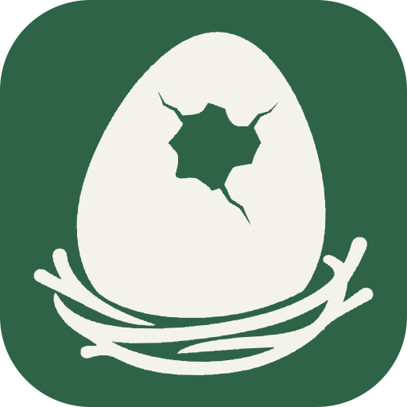

<h1>
  <picture>
    <source media="(prefers-color-scheme: dark)" srcset="../../public/img/icon-dark.svg">
    <source media="(prefers-color-scheme: light)" srcset="../../public/img/icon-light.svg">
    
  </picture>&ensp;dino-nest
</h1>

A Docusaurus starter template for personal knowledge and project documentation.

[](../../LICENSE)
[](https://github.com/4BFC/dino-nest/generate)
[](https://github.com/RichardLitt/standard-readme)

Keep your notes, learning, and project context in a site you own. Write in Markdown or MDX,
organize pages in folders, and find them through navigation and search.

<div align="center">
<table align="center">
  <tr>
    <td align="center"><a href="README.md"></a></td>
    <td align="center"><a href="../ko/README.md"></a></td>
    <td align="center"><a href="../jp/README.md"></a></td>
  </tr>
</table>
</div>

The site opens in English. Use the language icon in the top bar to switch the current document to 한국어 or 日本語.
Language switching is available in the built site; development previews serve one locale at a time.

## Table of Contents

- [Specifications](#specifications)
- [Install](#install)
- [Usage](#usage)
- [Features](#features)
- [Maintainer](#maintainer)
- [Contributing](#contributing)
- [License](#license)

## Specifications

Versions come from [package.json](../../package.json) and [pnpm-lock.yaml](../../pnpm-lock.yaml). Node.js shows the supported major version; the required range is `>=24.22.1 <25`.

| Component | Technology | Description |
| --- | --- | --- |
| Site engine |  | Creates the document site |
| Interface |  | Displays interactive pages |
| Runtime |  | Required to run and build the site |
| Package manager |  | Installs dependencies and runs commands |
| Preset |  | `@dino-ovum/preset`: document, search, PWA, and shared plugin configuration |
| Theme |  | `@dino-ovum/theme`, installed with the preset: shared UI, components, styles, fonts, and UI translations |

## Install

1. Select [Use this template](https://github.com/4BFC/dino-nest/generate) to create your own repository, then clone it.
2. Install Node.js 24 (`>=24.22.1 <25`) and pnpm 10.5.2.
3. In your repository directory, install dependencies:

```bash
pnpm install --frozen-lockfile
```

See the [setup guide](./CONTRIBUTING.md#development-setup) if you need help with the tools.

## Usage

Start your local site:

```bash
pnpm start
```

Open `http://localhost:3000`. Edit `documents/home.mdx` to introduce your space.
English documents live in `documents/`; Korean and Japanese translations live in `documents/_translations/ko/` and `documents/_translations/ja/`.
Add a file such as `documents/first-note.md` to publish a note:

```md
---
title: My first note
slug: /notes/first-note
---

Write what you learned and what you want to remember.
```

The note appears at `/notes/first-note` and in the navigation. Put related notes in the same folder.
Use the navigation toggle to open or close the panel, and the sun or moon button to change the theme.
Document search is available in the built site; use the navigation while running the development server.

| To personalize | Edit |
| --- | --- |
| Your introduction | `documents/home.mdx` |
| Notes and project records | Files in `documents/` |
| Site name, description, and public URL | `docusaurus.config.js` |
| Logo | `public/img/icon-light.svg`, `public/img/icon-dark.svg` |
| Site-wide styles | `src/globals.scss` |
| Styles for specific content | `src/styles` |

Each location in `src` includes a file to start from; the [site structure guide](./CONTRIBUTING.md#the-src-folder) explains them.
Before sharing your site, replace the example URL in `docusaurus.config.js` and review the documents you intend to publish.
The [publishing guide](./CONTRIBUTING.md#publishing) covers hosting.
Shared design and features come from the Dino Ovum packages; update `@dino-ovum/preset` to receive improvements.
Later changes to this template's own files are not applied to your repository automatically.

## Features

- Folder navigation, document lists, and search.
- A collapsible sidebar, mobile navigation, and light and dark themes.
- English, Korean, and Japanese documents with a language selector that keeps your current page.
- Installable app support and offline caching in production builds.
- Shared design and features from Dino Ovum packages, updated by changing one package version.

The starter includes a home page, an MIT License page, and a README writing guide. Add your own content as you go.
Built with [Docusaurus](https://docusaurus.io/), [React](https://react.dev/), and [Dino Ovum](https://github.com/4BFC/dino-ovum).

## Maintainer

[4BFC](https://github.com/4BFC)

## Contributing

Questions and bug reports are welcome in [GitHub Issues](https://github.com/4BFC/dino-nest/issues).
Pull requests are welcome; read [CONTRIBUTING](./CONTRIBUTING.md) for setup, checks, and the contribution workflow.

## License

[MIT](../../LICENSE), Copyright (c) 2026 [4BFC](https://github.com/4BFC).
Keep the copyright and permission notice when redistributing the code.
Fonts and dependencies retain their own licenses.
