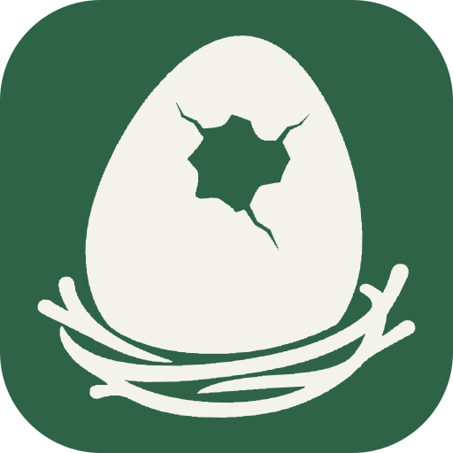

<h1>
  <picture>
    <source media="(prefers-color-scheme: dark)" srcset="../../public/img/icon-dark.svg">
    <source media="(prefers-color-scheme: light)" srcset="../../public/img/icon-light.svg">
    
  </picture>&ensp;dino-nest
</h1>

個人の知識やプロジェクトの記録を整理するための、Docusaurus スターターテンプレートです。

[](../../LICENSE)
[](https://github.com/4BFC/dino-nest/generate)
[](https://github.com/RichardLitt/standard-readme)

学んだことやプロジェクトの背景を、自分のサイトにまとめましょう。Markdown や MDX で文章を書き、
フォルダーで整理して、ナビゲーションや検索から必要な情報を見つけられます。

<div align="center">
<table align="center">
  <tr>
    <td align="center"><a href="../eng/README.md"></a></td>
    <td align="center"><a href="../ko/README.md"></a></td>
    <td align="center"><a href="README.md"></a></td>
  </tr>
</table>
</div>

サイトの既定言語は英語です。上部の言語アイコンで、表示中の文書を韓国語または日本語に切り替えられます。
言語の切り替えはビルド済みのサイトで利用できます。開発プレビューは一度に一つの言語を提供します。

## 目次

- [仕様](#仕様)
- [インストール](#インストール)
- [使い方](#使い方)
- [主な機能](#主な機能)
- [メンテナー](#メンテナー)
- [貢献](#貢献)
- [ライセンス](#ライセンス)

## 仕様

バージョンは [package.json](../../package.json) と [pnpm-lock.yaml](../../pnpm-lock.yaml) に基づきます。Node.js は対応するメジャーバージョンで、必要な範囲は `>=24.22.1 <25` です。

| 構成 | 技術 | 説明 |
| --- | --- | --- |
| サイトエンジン |  | 文書サイトを生成 |
| 画面 |  | 操作に応じた画面を表示 |
| 実行環境 |  | サイトの起動とビルドに必要 |
| パッケージ管理 |  | パッケージのインストールとコマンドの実行 |
| プリセット |  | `@dino-ovum/preset`：文書・検索・PWA と共通プラグインの設定 |
| テーマ |  | `@dino-ovum/theme`、preset と一緒にインストール：共通 UI・コンポーネント・スタイル・フォント・UI 翻訳 |

## インストール

1. [Use this template](https://github.com/4BFC/dino-nest/generate) で自分のリポジトリを作成し、クローンします。
2. Node.js 24 (`>=24.22.1 <25`) と pnpm 10.5.2 を用意します。
3. クローンしたリポジトリのディレクトリで、必要なパッケージをインストールします。

```bash
pnpm install --frozen-lockfile
```

ツールの準備については、[環境設定ガイド](./CONTRIBUTING.md#開発環境)をご覧ください。

## 使い方

ローカルサイトを起動します。

```bash
pnpm start
```

`http://localhost:3000` を開きます。`documents/home.mdx` を編集して、自分のサイトを紹介しましょう。
新しい記事は、`documents/first-note.md` のようにファイルを追加して作成できます。

```md
---
title: 最初のノート
slug: /notes/first-note
---

学んだことや覚えておきたいことを書きます。
```

記事は `/notes/first-note` とナビゲーションに表示されます。関連する記事は同じフォルダーにまとめましょう。
ナビゲーションボタンでパネルを開閉し、太陽または月のボタンでテーマを切り替えられます。
文書検索はビルド後のサイトで利用できます。開発サーバーではナビゲーションを使ってください。

| 変更したいもの | 編集する場所 |
| --- | --- |
| 自己紹介 | `documents/home.mdx` |
| 学習記録やプロジェクトの文書 | `documents/` 内のファイル |
| サイト名、説明、公開 URL | `docusaurus.config.js` |
| ロゴ | `public/img/icon-light.svg`, `public/img/icon-dark.svg` |
| サイト全体のスタイル | `src/globals.scss` |
| 特定のコンテンツだけに使うスタイル | `src/styles` |

`src` の各場所には出発点となるファイルが入っています。詳しくは[サイト構成ガイド](./CONTRIBUTING.md#src-フォルダー)をご覧ください。
サイトを共有する前に、`docusaurus.config.js` のサンプル URL を変更し、公開する文書を確認してください。
ホスティングについては[公開ガイド](./CONTRIBUTING.md#公開)をご覧ください。
共通のデザインと機能は Dino Ovum パッケージが提供します。`@dino-ovum/preset` を更新すると改善を受け取れます。
元のテンプレート自体のファイルの更新は、自分のリポジトリには自動で反映されません。

## 主な機能

- フォルダー別のナビゲーション、文書一覧、検索。
- 折りたたみ式サイドバー、モバイルナビゲーション、ライトテーマとダークテーマ。
- 本番ビルドでのアプリのインストールとオフラインキャッシュ。
- Dino Ovum パッケージが提供する共通のデザインと機能。パッケージのバージョン一つで更新。

初期状態ではホーム、MIT License、README 作成基準のページが含まれています。必要な文書を少しずつ追加してください。
[Docusaurus](https://docusaurus.io/)、[React](https://react.dev/)、[Dino Ovum](https://github.com/4BFC/dino-ovum) で作られています。

英語の文書は `documents/`、韓国語と日本語の翻訳は `documents/_translations/ko/`、`documents/_translations/ja/` で管理します。
上部の言語選択で、表示中の文書の翻訳版に移動できます。

## メンテナー

[4BFC](https://github.com/4BFC)

## 貢献

質問や不具合の報告は [GitHub Issues](https://github.com/4BFC/dino-nest/issues) にお寄せください。
Pull Request も歓迎します。開発環境、チェック、貢献の手順は [CONTRIBUTING](./CONTRIBUTING.md) をご覧ください。

## ライセンス

[MIT](../../LICENSE)、Copyright (c) 2026 [4BFC](https://github.com/4BFC)。
コードを再配布する際は、著作権表示と許諾文を保持してください。
フォントと依存パッケージには、それぞれのプロジェクトのライセンスが適用されます。
