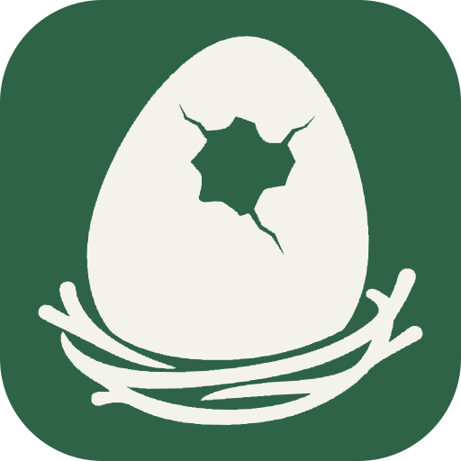

<h1>
  <picture>
    <source media="(prefers-color-scheme: dark)" srcset="../../public/img/icon-dark.svg">
    <source media="(prefers-color-scheme: light)" srcset="../../public/img/icon-light.svg">
    
  </picture>&ensp;dino-nest
</h1>

개인 지식과 프로젝트 기록을 위한 Docusaurus 스타터 템플릿입니다.

[](../../LICENSE)
[](https://github.com/4BFC/dino-nest/generate)
[](https://github.com/RichardLitt/standard-readme)

배운 것과 프로젝트의 맥락을 나만의 사이트에 모아 보세요. Markdown이나 MDX로 글을 쓰고,
폴더로 정리한 뒤 탐색 메뉴와 검색으로 필요한 내용을 찾을 수 있습니다.

<div align="center">
<table align="center">
  <tr>
    <td align="center"><a href="../eng/README.md"></a></td>
    <td align="center"><a href="README.md"></a></td>
    <td align="center"><a href="../jp/README.md"></a></td>
  </tr>
</table>
</div>

사이트의 기본 언어는 영어입니다. 상단 번역 아이콘에서 현재 문서를 한국어 또는 일본어로 전환할 수 있습니다.
언어 전환은 빌드된 사이트에서 사용할 수 있습니다. 개발 미리보기는 한 번에 한 언어만 제공합니다.

## 목차

- [스펙](#스펙)
- [설치](#설치)
- [사용법](#사용법)
- [주요 기능](#주요-기능)
- [관리자](#관리자)
- [기여](#기여)
- [라이선스](#라이선스)

## 스펙

버전은 [package.json](../../package.json)과 [pnpm-lock.yaml](../../pnpm-lock.yaml)을 기준으로 합니다. Node.js는 지원하는 주 버전이며, 요구 범위는 `>=24.22.1 <25`입니다.

| 구성 | 기술 | 설명 |
| --- | --- | --- |
| 사이트 엔진 |  | 문서 사이트 생성 |
| 화면 |  | 사용자와 상호작용하는 화면 표시 |
| 실행 환경 |  | 사이트 실행과 빌드에 필요 |
| 패키지 관리 |  | 패키지 설치와 명령 실행 |
| 프리셋 |  | `@dino-ovum/preset`: 문서·검색·PWA와 공통 플러그인 구성 |
| 테마 |  | `@dino-ovum/theme`, preset과 함께 설치: 공통 UI·컴포넌트·스타일·폰트·UI 번역 |

## 설치

1. [Use this template](https://github.com/4BFC/dino-nest/generate)로 나만의 저장소를 만들고 복제합니다.
2. Node.js 24 (`>=24.22.1 <25`)와 pnpm 10.5.2를 준비합니다.
3. 복제한 저장소 폴더에서 필요한 패키지를 설치합니다.

```bash
pnpm install --frozen-lockfile
```

도구 준비가 필요하면 [환경 설정 안내](./CONTRIBUTING.md#개발-환경)를 참고하세요.

## 사용법

로컬 사이트를 실행합니다.

```bash
pnpm start
```

`http://localhost:3000`을 엽니다. `documents/home.mdx`를 수정해 나의 공간을 소개해 보세요.
새 기록은 `documents/first-note.md`처럼 파일을 추가하면 됩니다.

```md
---
title: 첫 번째 기록
slug: /notes/first-note
---

배운 것과 기억하고 싶은 내용을 작성합니다.
```

추가한 글은 `/notes/first-note`와 탐색 메뉴에서 볼 수 있습니다. 관련 글은 같은 폴더에 모아 보세요.
탐색 버튼으로 패널을 접고 펼치고, 해 또는 달 버튼으로 화면 테마를 바꿀 수 있습니다.
문서 검색은 빌드한 사이트에서 사용할 수 있습니다. 개발 서버에서는 탐색 메뉴를 이용하세요.

| 바꾸고 싶은 것 | 수정할 곳 |
| --- | --- |
| 나의 소개 | `documents/home.mdx` |
| 학습 기록과 프로젝트 문서 | `documents/` 안의 파일 |
| 사이트 이름, 설명, 공개 주소 | `docusaurus.config.js` |
| 로고 | `public/img/icon-light.svg`, `public/img/icon-dark.svg` |
| 사이트 스타일 | `src/css/custom.css` |

사이트를 공유하기 전 `docusaurus.config.js`의 예제 주소를 바꾸고 공개할 문서를 확인하세요.
호스팅 방법은 [배포 안내](./CONTRIBUTING.md#배포)에 있습니다.
공통 디자인과 기능은 Dino Ovum 패키지가 제공합니다. `@dino-ovum/preset`을 갱신하면 개선 사항을 받을 수 있습니다.
원본 템플릿 자체 파일의 후속 변경은 내가 만든 저장소에 자동으로 반영되지 않습니다.

## 주요 기능

- 폴더별 탐색, 문서 목록과 검색.
- 접이식 사이드바, 모바일 탐색, 라이트와 다크 테마.
- 배포 빌드의 앱 설치와 오프라인 캐시.
- Dino Ovum 패키지가 제공하는 공통 디자인과 기능, 패키지 버전 하나로 업데이트.

처음에는 홈, MIT License, README 작성 기준 페이지가 들어 있습니다. 필요한 문서를 하나씩 추가해 보세요.
[Docusaurus](https://docusaurus.io/), [React](https://react.dev/), [Dino Ovum](https://github.com/4BFC/dino-ovum)으로 만들었습니다.

영어 문서는 `documents/`, 한국어와 일본어 번역은 `documents/_translations/ko/`, `documents/_translations/ja/`에서 관리합니다.
상단 언어 선택은 현재 문서의 번역본으로 이동합니다.

## 관리자

[4BFC](https://github.com/4BFC)

## 기여

질문과 버그 제보는 [GitHub Issues](https://github.com/4BFC/dino-nest/issues)에 남겨 주세요.
Pull Request도 환영합니다. 개발 환경, 검사와 기여 절차는 [CONTRIBUTING](./CONTRIBUTING.md)을 참고하세요.

## 라이선스

[MIT](../../LICENSE), Copyright (c) 2026 [4BFC](https://github.com/4BFC).
코드를 재배포할 때 저작권 고지와 허가문을 유지하세요.
글꼴과 의존성에는 각 프로젝트의 라이선스가 적용됩니다.
